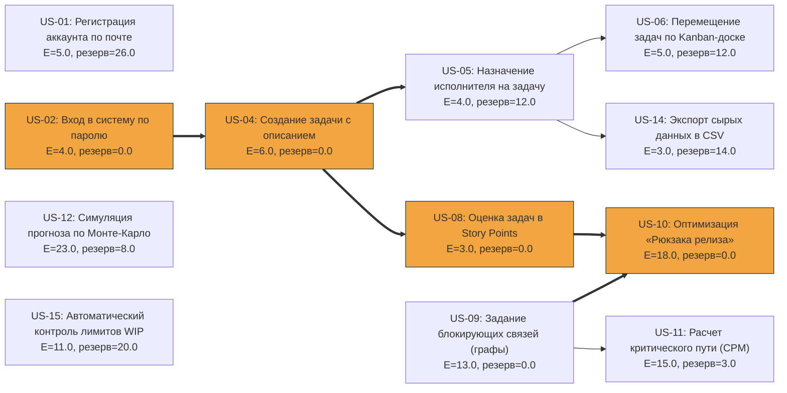

# Сетевой график, PERT-анализ сроков и прогноз Монте-Карло

**Цель:** Построить сетевой график для выбранного состава MVP, определить критический путь и временные резервы задач на основе реального вывода расчетного скрипта `pert_cpm.py`, а также рассчитать математическую вероятность завершения проекта к дате защиты по методу PERT.

---

## 1. Сетевой график и анализ критического пути (CPM)

Расчёт параметров временных характеристик бэклога и технологических зависимостей произведен в автоматическом режиме с помощью локального скрипта. 

### Временные параметры сетевого графика (в часах):

| ID задачи | E (ч) | σ | ES | EF | LS | LF | Резерв | Задача |
| :--- | :---: | :---: | :---: | :---: | :---: | :---: | :---: | :--- |
| **US-01** | 5.00 | 1.00 | 0.00 | 5.00 | 26.00 | 31.00 | **26.00** | Регистрация аккаунта по почте |
| **US-02\*** | 4.00 | 1.00 | 0.00 | 4.00 | 0.00 | 4.00 | **0.00** | Вход в систему по паролю |
| **US-04\*** | 6.00 | 1.00 | 4.00 | 10.00 | 4.00 | 10.00 | **0.00** | Создание задачи с описанием |
| **US-05** | 4.00 | 1.00 | 10.00 | 14.00 | 22.00 | 26.00 | **12.00** | Назначение исполнителя на задачу |
| **US-08\*** | 3.00 | 1.00 | 10.00 | 13.00 | 10.00 | 13.00 | **0.00** | Оценка задач в Story Points |
| **US-06** | 5.00 | 1.61 | 14.00 | 19.00 | 26.00 | 31.00 | **12.00** | Перемещение задач по Kanban-доске |
| **US-14** | 3.00 | 1.00 | 14.00 | 17.00 | 28.00 | 31.00 | **14.00** | Экспорт сырых данных в CSV |
| **US-09\*** | 13.00 | 3.00 | 0.00 | 13.00 | 0.00 | 13.00 | **0.00** | Задание блокирующих связей (графы) |
| **US-10\*** | 18.00 | 4.67 | 13.00 | 31.00 | 13.00 | 31.00 | **0.00** | Оптимизация «Рюкзака релиза» |
| **US-11** | 15.00 | 3.00 | 13.00 | 28.00 | 16.00 | 31.00 | **3.00** | Расчет критического пути (CPM) |
| **US-12** | 23.00 | 6.33 | 0.00 | 23.00 | 8.00 | 31.00 | **8.00** | Симуляция прогноза по Монте-Карло |
| **US-15** | 11.00 | 3.00 | 0.00 | 11.00 | 20.00 | 31.00 | **20.00** | Автоматический контроль лимитов WIP |

*\* — Задача лежит на критическом пути.*

### Анализ критического пути:
* **Фактический критический путь:** `US-02` $\rightarrow$ `US-04` $\rightarrow$ `US-08` $\rightarrow$ `US-10`.
* **Минимальная общая длительность проекта ($T_{critical}$):** **31.00 часов**.
* **Среднеквадратическое отклонение проекта ($\sigma$):** **4.98**.

---

## 2. Вероятностный прогноз сроков завершения по PERT

На основе статистических параметров критического пути скрипт рассчитал распределение вероятностей завершения проекта к различным директивным срокам:

* **Срок с вероятностью 50% (Медианный):** **31.00 ч.**
* **Срок с вероятностью 85% (Реалистичный):** **36.18 ч.**
* **Срок с вероятностью 90% (Безопасный):** **37.37 ч.**
* **Срок с вероятностью 95% (Пессимистичный):** **39.21 ч.**

Если установить жесткое директивное время на сдачу проекта равным $T_{scheduled} = 20$ часам, то математическая **вероятность завершить проект к этому сроку составляет всего 1.4%**, что указывает на критическую нехватку времени без оптимизации состава задач или привлечения дополнительных ресурсов.

---

## 3. Код визуализации графа (Mermaid)

Ниже представлен сгенерированный скриптом код направленного графа для вставки в структуру отчетности репозитория:

---

## Выводы
Фактический расчёт выявил скрытое технологическое бутылочное горлышко: из-за жестких алгоритмических связей ядро оптимизации системы (`US-10`) легло на критический путь вместе с авторизацией и оценкой в Story Points. Любая задержка на вехах `US-02`, `US-04`, `US-08` и `US-10` приведет к немедленному сдвигу финального дедлайна. Для минимизации рисков срыва (риск оценивается границей в 36.18 ч с надежностью 85%) команде необходимо провести ревью архитектуры связей с целью распараллеливания задач.
