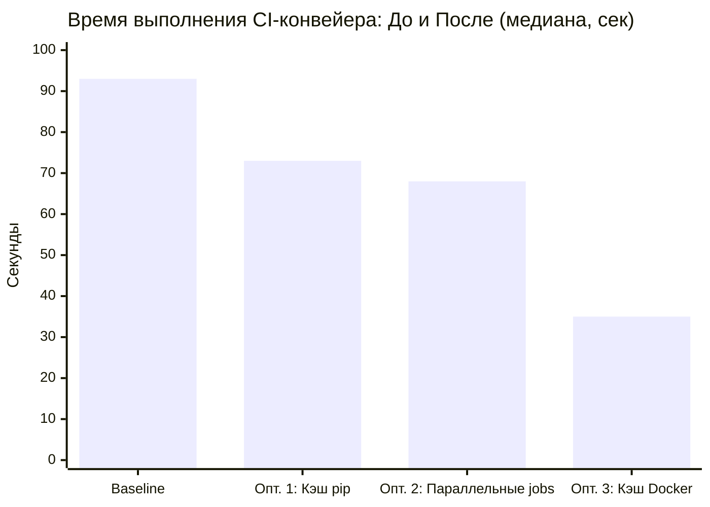

# Измерение и оптимизация конвейера непрерывной интеграции (`ci-optimization.md`)

**Проект:** Автоматизированный таск-трекер «OptiPlan»  
**Этап:** Лабораторная работа № 2 — Инженерный конвейер: Git-процесс, ревью и непрерывная интеграция  
**Авторы:** Сухарев Андрей (Участник А), Даниил Антонюк (Участник Б)

---

## 1. Цель работы
Измерить базовую производительность конвейера непрерывной интеграции (GitHub Actions), последовательно применить методы оптимизации сборки и тестирования, оценить их влияние на общее время прохождения проверок (медиана по 5 запускам) и определить критический путь оптимизированного конвейера.

---

## 2. Исходные данные и методика измерений

* **Платформа CI:** GitHub Actions (`ubuntu-latest`).
* **Этапы конвейера:** инициализация окружения (`setup`), установка зависимостей (`pip install`), статический анализ и проверка форматирования (`ruff`), модульное тестирование с расчётом покрытия (`pytest --cov=app`), сборка Docker-образа (`docker build`).
* **Метрика оценки:** медиана длительности выполнения (в секундах) по **5 последовательным запускам** для каждой конфигурации. Использование медианы вместо среднего арифметического позволяет нивелировать случайные выбросы, вызванные загрузкой облачных раннеров GitHub.
* **Исходные данные:** `docs/02-pipeline/data/ci_timings.csv`.
* **Скрипт расчёта и визуализации:** `scripts/analyze_ci.py`.

---

## 3. Ход выполнения и применённые оптимизации

### 3.1. Базовая линия (Baseline)
В исходной конфигурации все шаги выполнялись последовательно внутри одного `job` без использования кэширования:
1. Каждый запуск заново скачивал и устанавливал Python-пакеты из PyPI.
2. Проверки линтера (`ruff`) и тесты (`pytest`) выполнялись друг за другом.
3. Сборка Docker-образа каждый раз выполнялась «с нуля» без переиспользования слоёв.

**Медианное время базового конвейера:** **93 с** (установка зависимостей — 24 с, линтер — 4 с, тесты — 9 с, сборка Docker — 48 с).

---

### 3.2. Последовательное внедрение оптимизаций

1. **Оптимизация 1 — Кэширование зависимостей Python (`cache: pip`)**
   * **Реализация:** В шаг `actions/setup-python@v5` добавлен параметр `cache: pip`, привязанный к хэшу файла `requirements.txt`.
   * **Эффект:** Время установки зависимостей сократилось с **24 с** до **6 с** (−75%). Общее медианное время конвейера снизилось до **73 с** (−20 с).

2. **Оптимизация 2 — Распараллеливание независимых проверок (Parallel Jobs)**
   * **Реализация:** Единый `job` разделён на два независимых параллельных потока: `lint` (линтер и форматтер) и `test` (поднятие PostgreSQL и прогон `pytest`), а джоб `build` запускается только после их успешного завершения (`needs: [lint, test]`).
   * **Эффект:** Быстрая проверка стиля кода (`lint`, ~14 с с учётом подготовки окружения) перестала блокировать запуск тестов и перестала увеличивать общее время пайплайна. Общее медианное время снизилось до **68 с** (−25 с от baseline).

3. **Оптимизация 3 — Кэширование слоёв Docker (`type=gha`)**
   * **Реализация:** Стандартный `docker build` заменён на `docker/setup-buildx-action@v3` и `docker/build-push-action@v6` с сохранением кэша слоёв в хранилище GitHub Actions (`cache-from: type=gha`, `cache-to: type=gha,mode=max`).
   * **Эффект:** Наибольший прирост производительности. При неизменном `requirements.txt` слой установки системных пакетов и Python-зависимостей берётся из кэша. Время сборки образа упало с **47–48 с** до **14 с** (−70.8%). Общее медианное время конвейера составило **35 с**.

4. **Оптимизация 4 (дополнительная) — Отмена устаревших запусков (`concurrency`) и фильтры путей (`paths-ignore`)**
   * **Реализация:** Настроена группа `concurrency: group: ci-${{ github.ref }}` с флагом `cancel-in-progress: true`, а также игнорирование изменений в `docs/**` и `**.md`.
   * **Эффект:** Не влияет на длительность одиночного прогона при изменении кода, но сокращает время ожидания на **100%** при работе над документацией и предотвращает очередь из устаревших проверок при серии быстрых коммитов в Pull Request.

---

## 4. Сравнительная таблица «До / После»

В таблице приведены медианные значения (по 5 запускам на каждый этап) в секундах:

| Этап конвейера | Setup | Установка зависимостей | Linter (`ruff`) | Тесты (`pytest`) | Сборка Docker | Итоговое время (медиана) | Изменение к Baseline |
| :--- | :---: | :---: | :---: | :---: | :---: | :---: | :---: |
| **Baseline** (без оптимизаций) | 8 с | 24 с | 4 с | 9 с | 48 с | **93 с** | — |
| **Опт. 1:** Кэш `pip` | 7 с | 6 с | 4 с | 9 с | 47 с | **73 с** | **−20 с (−21.5%)** |
| **Опт. 2:** Параллельные `jobs` | 7 с | 5 с | 4 с | 9 с | 47 с | **68 с** | **−25 с (−26.9%)** |
| **Опт. 3:** Кэш слоёв Docker | 7 с | 5 с | 4 с | 9 с | 14 с | **35 с** | **−58 с (−62.4%)** |

### Визуализация результатов



## 5. Анализ критического пути конвейера

После разделения конвейера на параллельные задачи (`lint`, `test` → `build`) граф зависимостей выглядит следующим образом:

```text
           ┌──▶ [ Job: lint (16 с) ] ──┐
(Start) ───┤                           ├──▶ [ Job: build (14 с) ] ──▶ (Finish)
           └──▶ [ Job: test (21 с) ] ──┘
```

* **Формула расчёта длительности:**
  $$T_{\text{total}} = \max(T_{\text{lint}}, T_{\text{test}}) + T_{\text{build}}$$
* **Критический путь (Critical Path):** **`test` (21 с) → `build` (14 с) = 35 с**.
* **Резерв времени (Slack) ветки `lint`:** $21\text{ с} - 16\text{ с} = 5\text{ с}$.

**Инженерный вывод:** Дальнейшее ускорение джоба `lint` (например, с 16 с до 10 с) **не уменьшит** общее время работы конвейера, так как он не лежит на критическом пути и в любом случае ожидает завершения джоба `test`. Точками дальнейшего роста являются только уменьшение времени запуска контейнера БД в `test` или оптимизация базового Docker-образа в `build`.

---

## 6. Выводы
1. Применение четырёх инженерных оптимизаций позволило сократить медианное время прохождения CI-конвейера с **93 с** до **35 с** (ускорение в **2.65 раза** или на **62.4%**).
2. Наибольший эффект дало **кэширование слоёв Docker (`type=gha`)**, сократившее самый тяжёлый этап сборки образа на 33 секунды.
3. Быстрый фидбек (~35 секунд на проверку PR) снижает время ожидания ревью и напрямую поддерживает целевые показатели времени цикла (Cycle Time) команды в рамках процесса Scrumban.

---

## 7. Воспроизводимость расчётов
Для повторного расчёта медиан и перегенерации диаграммы выполните из корня репозитория:
```bash
python scripts/analyze_ci.py
```
